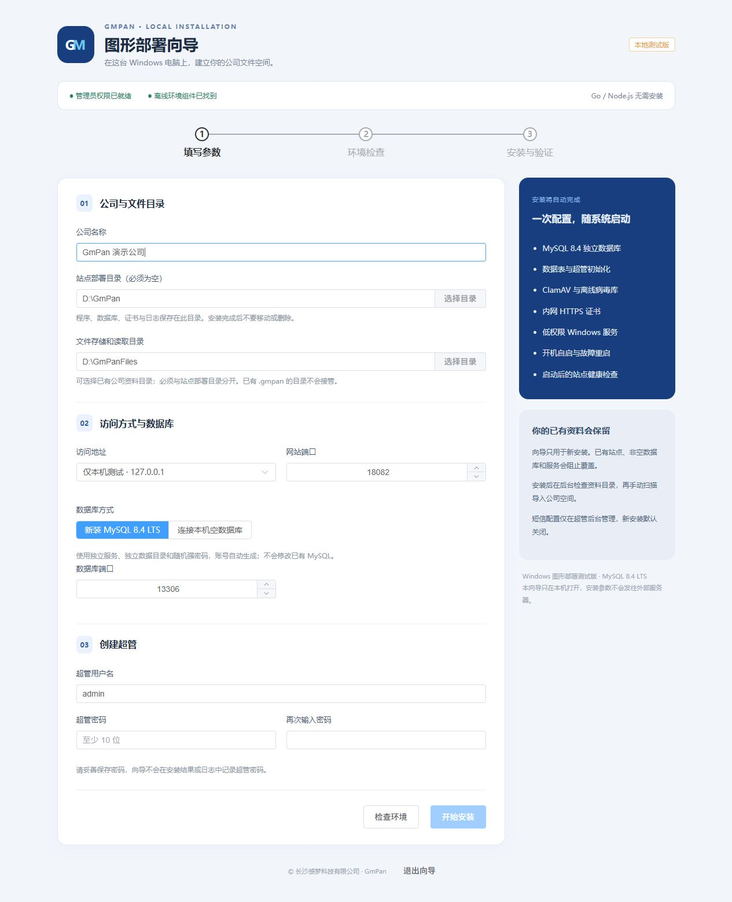

# GmPan 图形部署测试说明

本向导支持 Windows x64 **全新安装测试、卸载服务和本机重置超管密码**，现有业务环境先备份。部署电脑无需 Go、Node.js、手工执行 PowerShell 脚本或手工编辑 `config.json`。需要本机管理员权限及现代浏览器。

## 一、找到完整包

完整目录包含 `GmPan安装向导.exe`、`gmpan.exe`、`payload`、使用许可及本说明。只有普通源码、单个 exe 或不含 `payload` 的基础构建目录，不能自动安装完整环境。新版单独的 `GmPan安装向导.exe` 仍可用于卸载服务和重置超管密码，无需重新下载完整环境组件。

将完整 ZIP 复制到待部署电脑，右键“全部解压”，例如解压到 `D:\GmPan安装包`。不要在压缩包里直接运行，不要把安装包目录当作站点部署目录。

## 二、双击部署

1. 双击 **GmPan安装向导.exe**。Windows 询问是否允许更改设备时选择“是”；若未自动提权，右键“以管理员身份运行”。未做代码签名的测试程序可能被 SmartScreen 提醒，请核实来源及 SHA256 后再运行。
2. 默认浏览器会打开只在本机监听的安装向导。点击“选择目录”会在当前页面显示本机磁盘与文件夹，进入目标文件夹后点击“选择当前目录”，不会再打开可能被浏览器遮挡的系统窗口。也可直接在表单输入完整的新目录路径，安装时创建。网页刷新后若提示连接失效，请退出原向导再重新运行。
3. 填写公司名称。站点部署目录选择新的空目录，例如 `D:\GmPan`。若该目录已有配置或程序，改用新的空目录，例如 `D:\GmPanTest`，不要删除旧资料。
4. 文件存储和读取目录例如 `D:\sucai`，不能放在站点部署目录内，也不能包含程序目录。可以保留原始公司文件；已有 `.gmpan` 的目录不会被本向导接管。
5. 初次验证可以选择“仅本机测试 · 127.0.0.1”，网站端口从 `18080` 起自动选择可用端口。需要公司电脑访问时，选择服务器的固定内网 IPv4，默认 `8443`，将生成 HTTPS 证书。端口已占用时选择其他端口。
6. 推荐“新装 MySQL 8.4 LTS”，数据库默认使用可用的 `13306` 附近端口，仅监听本机，独立服务，不会修改原 MySQL。连接已有数据库仅支持本机专用空库，不会覆盖或升级旧库；其原服务自启动需由原维护人员配置。
7. 填写超管账号和至少 10 字节的强密码，再次输入密码。短信不在此配置，安装后到超管后台管理。
8. 点击“检查环境”，通常几秒内返回；超过 20 秒会提示超时并恢复表单，不会开始安装。通过后点击“开始安装”。保持向导运行，等待组件解压、独立数据库初始化、ClamAV 实际扫描、服务启动及健康检查结束。
9. 完成后点击“打开 GmPan”，用刚设置的超管账号登录。关闭安装向导不会停止已安装的 Windows 服务。




## 三、测试和开机自启动

1. 检查首页公司名称；到后台创建一个测试员工和部门。
2. 测试目录上传、备注搜索、图片预览、视频播放、下载、回收站及权限。立即模式须安全检查通过后才能预览或下载；不启用或定时模式允许访问未检查文件并标注，检查失败和已发现威胁的文件仍阻止访问。
3. 到后台核对文件目录，确认目录中的原文件均可全员公开，再扫描导入公司空间。向导不会自动公开扫描原文件。
4. 按 `Win + R`，输入 `services.msc` 打开“服务”。新装模式下应看到 `GmPanMySQL84` 为自动启动，`GmPan` 为自动（延迟启动），均在运行。使用独立的 `NT SERVICE\...` 低权限服务账号。
5. 在可安排停机的测试电脑上重启，等待服务恢复，再打开安装结果中的地址并登录。开发电脑的服务重启验证不能代替目标电脑的整机重启验收。
6. 内网访问模式的防火墙规则仅允许专用/域网络内的同子网连接。若目标网卡被识别为“公用网络”，请由维护人员按公司策略核对，不要把端口开放到所有网络。

新版规则限定 GmPan 程序的 TCP 入站连接，可随后台变更监听端口，不影响其他程序。安装后可由超管到“站点配置 → 站点运行”保存新端口，再“重启站点”。已有旧版固定端口规则的电脑需由维护人员先允许新端口。

## 四、内网 HTTPS 证书

向导生成的是自签名内网证书，一年有效。首次访问出现证书信任提示不等于服务没有启动。

在每台员工电脑按公司流程双击部署目录 `certs\server.crt` →“安装证书”→“当前用户”→“将所有证书放入下列存储”→“受信任的根证书颁发机构”→完成。核实证书来自本公司服务器后再安装。重新打开浏览器，按安装时选择的内网 IP 访问。正式使用可替换为公司 CA 签发的证书。

只分发 `server.crt` 公钥证书，**绝不分发 `server.key` 私钥**。服务器 IP 改变或证书到期时需由维护人员重新配置证书；不要随意移动部署目录。

## 五、安装结果、日志与失败处理

| 文件/目录 | 用途 |
| --- | --- |
| `安装结果.txt` | 访问地址、超管账号、资料目录及服务说明，不记录超管密码 |
| `logs/setup.log` | 安装阶段记录，不记录输入密码及短信凭证 |
| `logs` 中的应用日志 | 日常运行和故障记录 |
| `mysql-data/mysql-error.log` | 新安装数据库的初始化和启动错误 |
| `database-recovery.txt` | 随机生成的数据库维护密码，仅 Windows 系统管理员可读，需保密备份 |
| `config.json` | 自动生成的运行参数和专用数据库连接，不含短信配置 |

安装失败时，向导停止并撤销本次创建的服务和防火墙规则，保留已经生成的文件和数据库，不自动删除资料。请记录错误阶段并检查日志。为避免覆盖，本版不会在部分安装目录中自动重跑；排查后换新的空部署目录重试。已经产生 `.gmpan` 的资料目录需先由维护人员核对，不能直接删掉作为重试步骤。

旧版选择目录后没有反应时，可用 `Alt + Tab` 找到被遮住的目录窗口并取消，再关闭旧向导、替换新版 `GmPan安装向导.exe` 后重新打开。新版使用页面内目录选择器。

环境检查超时不等于已开始安装。先核对路径所在磁盘能否正常打开、本机 Windows 服务是否正常，连接已有数据库时核对服务与端口。若重试仍提示检查正在运行，请退出并重新打开向导；检查阶段不会创建数据库、服务或更改文件权限。开始安装后的失败按前述日志和保留数据规则处理。

数据库维护密码不等于网页超管密码。不要把 `database-recovery.txt`、正式 `config.json`、证书私钥、真实资料和日志提交到 Git、发到聊天或公开截图。

短信统一在 **超管后台 → 站点配置 → 短信配置** 管理，保存后立即生效，新安装默认关闭。配置文件中的旧 `sms` 字段不会读取。

## 六、部署常见问题

### 卸载 / 清理旧服务（保留数据）

1. 双击新版 `GmPan安装向导.exe`，允许管理员提权后，点击“卸载 / 清理旧服务”。仅运行单个新版向导程序也可以卸载，不要求 `payload` 组件齐全。
2. 页面显示检测到的服务名、状态、启动路径、程序是否存在及需要保留的目录。默认选择识别成功的 GmPan 服务和同一部署目录的独立 MySQL 服务；逐项核对后再决定保留或移除哪些服务。
3. 勾选确认，再点击“卸载所选服务（保留数据）”并确认。运行中的服务会停止，员工访问会中断。必须先停止或同时移除依赖 MySQL 的 GmPan 服务，不能单独移除其数据库服务。
4. 向导按顺序停止并移除 GmPan、所选 GmPanMySQL84 的注册记录，并尝试清理对应安装的防火墙规则。未识别的同名服务和其他 MySQL 不会自动处理。程序文件已经删除的残留记录也支持清理。
5. 结果页回读服务状态；若 Windows 仍持有服务记录，会提示关闭“服务”及属性窗口，必要时重启电脑后再检查。防火墙规则未发现或清理未确认时，会显示规则名供管理员核对。

卸载**不会删除**部署程序、`mysql-data`、数据库维护凭据、`config.json`、证书、日志、原始资料或 `.gmpan` 上传数据。卸载日志写入 `%ProgramData%\GmPan\UninstallLogs`，仅本机管理员和系统账号可读。不提供“一键清空全部数据”，避免误删公司资料。

卸载后恢复旧站点应使用原数据库和配置，由维护人员恢复服务；全新安装必须使用新的空部署目录和独立数据环境，不能对保留数据重新初始化。

### 服务仍存在，但对应程序或部署目录已经删除，如何重新安装？

删除程序文件不会自动移除 Windows 服务注册记录，因此向导仍会提示“已存在 GmPan 服务”。只停止服务或改用另一个部署目录，均不能消除同名服务冲突。

先确认是恢复旧站点，还是放弃旧安装后全新安装。若还需保留旧站点，应优先从回收站或备份恢复程序、配置和数据库，并保留文件目录；不要为通过检查而删除数据库或资料。`mysql-data`、`config.json`、证书和资料目录的 `.gmpan` 如果仍在，先完整备份，由维护人员处理恢复。服务记录清理不能恢复已经删除的文件。

新版向导可先使用上方“卸载 / 清理旧服务（保留数据）”功能；无法识别的路径、等待删除的记录才需要人工处理。

以下人工步骤**仅适用于已确认废弃、可执行文件确实不存在的 GmPan 服务记录**，由部署电脑的管理员执行；每项服务单独核对，不清理其他 MySQL 或系统服务。

1. 退出所有安装向导。在“服务”中右键对应服务 →“属性”，记录“可执行文件的路径”，到资源管理器确认该 exe 确实不存在。`GmPanMySQL84` 要单独核对；不能只因 `gmpan.exe` 缺失，就认定 MySQL 也需要清理。
2. 关闭“服务”及其属性窗口。在开始菜单搜索“命令提示符”，右键选择“以管理员身份运行”。也可以使用管理员 PowerShell，但下面的命令必须写完整的 `sc.exe`，不要简写成 `sc`。
3. 查询服务记录和状态。`BINARY_PATH_NAME` 是配置的启动路径；若命令显示的服务与预期不符，先停止操作。

```powershell
sc.exe qc GmPan
sc.exe query GmPan
sc.exe qc GmPanMySQL84
sc.exe query GmPanMySQL84
```

4. 对已经确认废弃的服务执行停止命令，再查询状态。例如清理 `GmPan`：

```powershell
sc.exe stop GmPan
sc.exe query GmPan
```

看到 `STATE : 1 STOPPED` 后，移除这一项服务注册记录：

```powershell
sc.exe delete GmPan
```

5. **只有同样确认 `GmPanMySQL84` 的 exe 已删除且不再保留该安装时**，才按相同步骤处理数据库服务：

```powershell
sc.exe stop GmPanMySQL84
sc.exe query GmPanMySQL84
```

确认 `STOPPED` 后执行：

```powershell
sc.exe delete GmPanMySQL84
```

6. 回读检查：

```powershell
sc.exe query GmPan
sc.exe query GmPanMySQL84
```

`1060` 表示对应服务不存在，清理目标已经达到。只清理了一项时，只需该项返回 `1060`。`sc.exe delete` 移除的是服务注册记录，不会删除数据库、配置或文件资料。

| 提示/状态 | 处理 |
| --- | --- |
| 停止时提示 `1062`，服务尚未启动 | 再查询确认已停止，可以继续移除已确认废弃的记录 |
| `STOP_PENDING` | 等待停止完成，再查询；未停止前不继续清理 |
| `DeleteService SUCCESS`，但仍看到服务或提示 `1072`、已标记为删除 | 关闭服务管理器、属性窗口和所有向导，再查询；仍未消失时安排重启部署电脑，重启后再确认 |
| `5`，拒绝访问 | 关闭普通命令窗口，使用有本机管理员权限的账号“以管理员身份运行”；公司策略限制需由系统管理员处理 |
| `1060`，指定的服务不存在 | 无需重复删除该项 |
| 删除后向导仍报已有服务 | 退出旧向导重新打开，并重新核对报错中的准确服务名 |

确认不再存在需要清理的同名服务后，再打开完整部署包的向导，选择新的空部署目录。已有 `.gmpan` 的资料目录和非空数据库仍不能直接用于全新安装；应保留原数据，改用新的独立资料目录测试，或先按恢复流程处理。

命令行为参考 [Microsoft：sc delete](https://learn.microsoft.com/en-us/windows-server/administration/windows-commands/sc-delete) 与 [Microsoft：sc query](https://learn.microsoft.com/en-us/windows-server/administration/windows-commands/sc-query)。本节提供人工处理方法，安装向导不会自动删除已有服务或资料。

## 七、源码构建完整测试包

在 Windows 构建机准备经过官方校验的 MySQL 8.4 x64 ZIP、ClamAV x64 解压目录、有效病毒库（`main.cvd`、`daily.cvd`、`bytecode.cvd`）及签名有效的 Microsoft x64 运行库，再执行 `scripts/package-setup.ps1` 并提供各组件路径。脚本会构建应用和向导、保留第三方声明、写入组件 SHA256 清单并生成 ZIP。依赖文件和本地部署数据不提交到源码仓库。

第三方软件的原始许可仍然有效。完整依赖包当前用于本地测试；公开发行前需处理 MySQL、ClamAV 对应源码和 Microsoft 再分发要求，参见包中的 `THIRD-PARTY-NOTICES.md`。


## 八、忘记超管密码（浏览器生成密码后无法登录也适用）

原密码以不可逆散列保存，无法显示或找回原文；可以通过本机维护向导设置新密码。旧版向导没有“重置超管密码”按钮时，使用包含该功能的新版向导即可，不用重新安装站点，也不必替换正在运行的 `gmpan.exe`。


1. 在**部署服务器本机**保存新版 `GmPan安装向导.exe`，右键选择“以管理员身份运行”，允许 Windows 权限提示。可以放在独立工具目录；只使用密码恢复功能时不需要 `payload`。
2. 在自动打开的本机页面选择 **“重置超管密码”**。不要选择“全新安装”或卸载服务；保持原 MySQL 服务运行。
3. 点击“选择目录”，选择**安装后的原站点部署目录**，目录内应有实际使用的 `config.json`。例如程序安装到 `D:\GmPan`，就选择该目录；不能选择下载包的解压目录，也不能选择 `D:\sucai` 等资料目录。
4. 点击“读取原站点”，核对显示的配置目录、数据库名称，在下拉列表选择需要恢复的超管用户名。工具只显示现有、已启用的超管；不会创建账号、提升维护管理员权限或启用已停用账号。
5. 输入两次相同的新密码，长度为 **10～72 字节**，建议使用至少 12 位字母、数字和符号。浏览器生成密码时确认两栏相同，妥善保存；密码不会出现在结果或日志中。
6. 勾选“我已核对原站点和账号”，点击“确认重置超管密码”。看到成功提示后返回原站点登录页，用所选的**用户名**和新密码登录。手机号未绑定时不能用手机号代替用户名。清空浏览器自动填入的旧密码后再输入。
7. 重置会使该账号已有登录失效，并清除该账号的密码错误计数。其他员工的密码、登录、权限和文件资料保持不变，无需重装或重启站点。操作记录写入原数据库的 `audit_logs`，类型为 `local_admin_password_reset`。

| 提示 | 处理 |
| --- | --- |
| 没有“重置超管密码”按钮 | 关闭旧向导，运行支持密码恢复的新版向导；只需更新向导 exe |
| 目录没有原站点 config.json | 选安装完成后的实际程序目录，必要时通过 GmPan 服务属性核对启动配置路径；不要新建空配置来替代原配置 |
| 无法连接原数据库 | 在 Windows“服务”确认原 MySQL 服务运行，保留原连接配置；工具不会修改数据库账号或启动/停止服务 |
| 没有启用的超管 | 由仍可登录的超管检查账号状态；没有可用超管时交由维护人员核对原数据库，恢复工具不会自动解除停用 |
| 配置发生变化 | 重新点击“读取原站点”，再次核对账号后提交 |
| 等待超时或连接中断 | 结果可能尚未确认，先尝试新密码登录；仍失败再重新读取站点后重试，不执行初始化 |
| 仍提示尝试频繁 | 先停止反复尝试；账号计数已清除，但来自同一 IP 的其他账号触发的限频仍保留，等待 10 分钟后再试 |

恢复工具仅支持原 `config.json` 连接的**本机 MySQL 独立库**，不受 `GMPAN_DSN` 环境变量覆盖，不连接远程数据库，也不创建表。只有掌握部署电脑 Windows 管理员权限的人可以使用。已登录的超管也可以直接从“人员与部门 → 编辑账号 → 重置密码”设置新密码；普通员工的密码由超管或有权限的维护管理员在后台重置。

`init-admin` 仅用于空用户表首次创建超管，不能用于找回密码。不要删除 `users` 表、数据库或 `.gmpan` 目录来恢复登录。
