# GmPan 用户操作手册

适用于员工、部门管理员、维护管理员和超管。本文按当前已实现界面编写；截图采集于 2026 年 10 月 20 日，使用本地虚构演示数据。截图中的公司名称、账号、手机号和磁盘路径仅作说明，不作为正式环境配置，也不提供公共演示账号。

部署、服务、数据库、日志文件、备份和换盘迁移，请阅读[系统部署操作手册](系统部署操作手册.md)。

## 目录

1. [登录与账号](#一登录与账号)
2. [空间与角色权限](#二空间与角色权限)
3. [按目录查找资料](#三按目录查找资料)
4. [上传文件和文件夹](#四上传文件和文件夹)
5. [备注与搜索](#五备注与搜索)
6. [图片视频与文件预览](#六图片视频与文件预览)
7. [文件及目录下载](#七文件及目录下载)
8. [回收与恢复](#八回收与恢复)
9. [发布审核](#九发布审核)
10. [人员与部门管理](#十人员与部门管理)
11. [已有资料扫描](#十一已有资料扫描)
12. [站点与短信配置](#十二站点与短信配置)
13. [主题日志与日常维护](#十三主题日志与日常维护)
14. [常见问题](#十四常见问题)

## 一、登录与账号

1. 在公司网络内，用浏览器打开管理员提供的 GmPan 地址。非本机访问使用已受信任的 HTTPS 地址。
2. 选择“账号密码登录”，输入管理员开通的用户名，或已绑定的手机号，再输入密码。
3. 点击“登录”。没有账号或忘记密码时联系公司管理员，系统不开放自行注册。
4. 首次取得管理员分配的密码后，打开右上角账号菜单，选择“修改密码”，输入当前密码及两次新密码。新密码需为 10～72 字节；修改后重新登录，其他设备的会话也会失效。
5. 使用结束后从账号菜单“退出登录”，尤其是在公用电脑上。

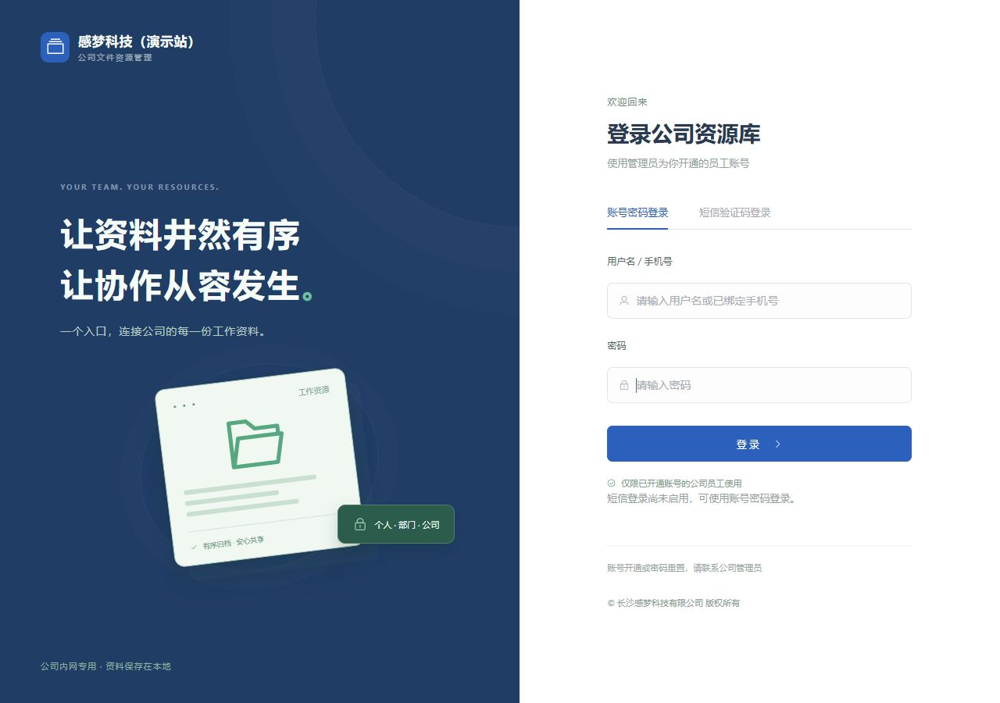

“手机号加密码”和“短信验证码登录”是两种方式。前者只需账号绑定手机号；后者需超管启用短信并完成平台配置。短信未启用时继续使用密码登录，不需要微信或企业微信。

忘记密码时，有权限的管理员可在“人员与部门 → 编辑账号 → 重置密码”设置新密码。唯一超管无法登录且未启用短信时，由部署电脑的 Windows 管理员使用新版安装与维护向导的“重置超管密码”功能。无需重新安装，步骤见[图形部署测试说明第八节](图形部署测试说明.md#八忘记超管密码浏览器生成密码后无法登录也适用)。浏览器自动填入旧密码时，请先清空后再输入新密码。

## 二、空间与角色权限

| 空间 | 员工可见范围 | 超管、维护管理员 |
| --- | --- | --- |
| 公司空间 | 所有有效员工可见已发布资料；未发布内容仅提交人及有审核权限的管理员可见 | 可查看、管理全部资料 |
| 部门空间 | 仅本部门；未发布内容按提交人和审核权限限制 | 可选择部门，查看、管理所有部门资料 |
| 个人空间 | 仅本人；部门管理员不能查看其他员工个人资料 | 可选择员工，查看、管理所有个人空间资料 |

| 角色 | 主要权限 |
| --- | --- |
| 员工 | 在自己的可见范围内上传、预览、下载，管理自己有管理权的文件；公司和部门共享文件提交后待审核 |
| 部门管理员 | 员工权限，以及管理、审核本部门资料；不管理其他部门或他人个人空间，不审核公司共享资料 |
| 维护管理员 | 管理所有空间文件、审核、人员部门、资料扫描和操作日志；不能配置站点、短信或 Logo，不能管理超管账号 |
| 超管 | 所有管理操作，包括站点配置、短信配置和超管账号管理 |

部门的父子层级只表示组织结构，不会自动互相开放文件。内部链接也不能绕过权限；转发链接后，接收人仍须登录并有相应文件权限。

管理员在“个人空间”或“部门空间”顶部选择归属后，上传、新建和搜索均针对所选空间。操作前先核对归属，避免把部门资料上传到自己的个人空间。

## 三、按目录查找资料

1. 左侧选择“公司空间”。
2. 在“公司目录”树中展开文件夹，点击目录名称；也可以点击表格的文件夹名称或“打开”。
3. 顶部面包屑显示当前位置，点击任一上级名称返回；上箭头返回上一级。
4. “全部 / 文件 / 视频 / 压缩包”只筛选显示类型，不移动文件。“文件”包括普通文档、图片和音频等。
5. 默认查看当前目录。需要连同下级目录查找时，勾选“包含子目录”。
6. 目录或资料刚更新时，使用目录树和资料列表的刷新按钮。

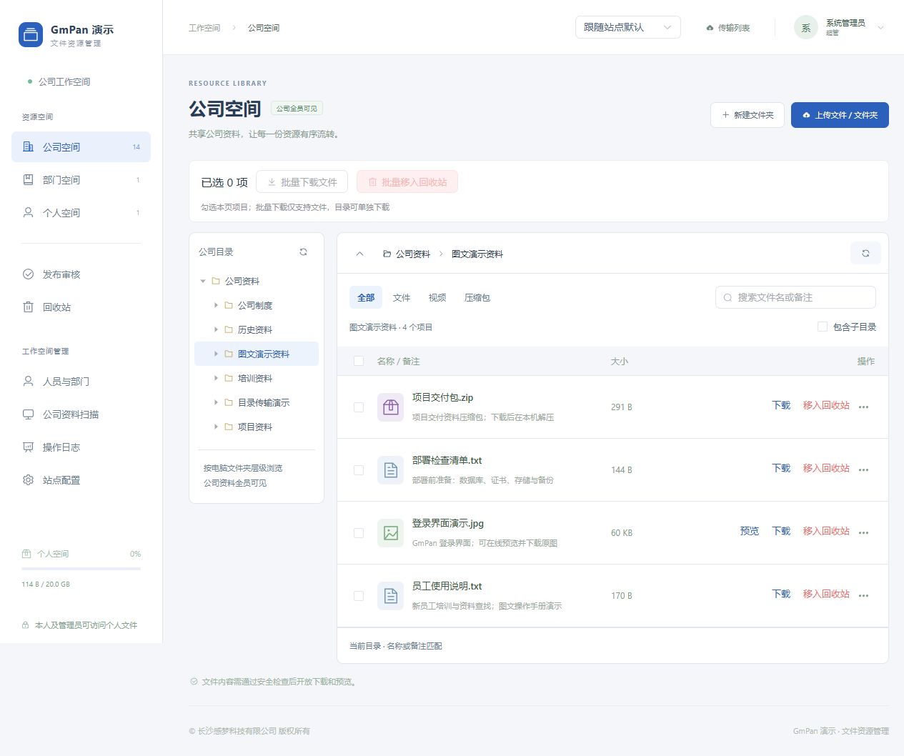

公司空间的“历史资料”来自部署服务器指定目录的扫描登记。磁盘中新加文件不会立即出现在页面，需管理员再次扫描；页面“刷新”不等于重新扫描磁盘。

## 四、上传文件和文件夹

### 普通文件上传

1. 进入目标空间和文件夹；管理员同时核对所选员工或部门归属。
2. 点击“上传文件 / 文件夹”。
3. 点击选择区选文件，也可拖入普通文件；支持一次选择多个文件。
4. 在每个文件对应的备注框填写用途或关键词，不必把全部说明写进文件名。
5. 核对上传目标和数量后，点击“上传 N 个文件”。
6. 在“传输列表”确认上传完成，按站点病毒检查策略等待或使用；共享资料还可能需要发布审核。

### 整个文件夹上传

1. 在同一上传窗口点击“选择文件夹上传”，选择需要上传的目录。
2. 核对清单中的相对路径，系统会保留目录层级；为其中的文件填写备注。
3. 确认每批不超过 500 个文件、2 GiB、32 层，文件和目录合计不超过 1000 项。较大的目录拆成多个批次。
4. 点击上传后在传输列表检查结果。浏览器选择目录通常不包含空文件夹，空目录需要在页面手工新建。

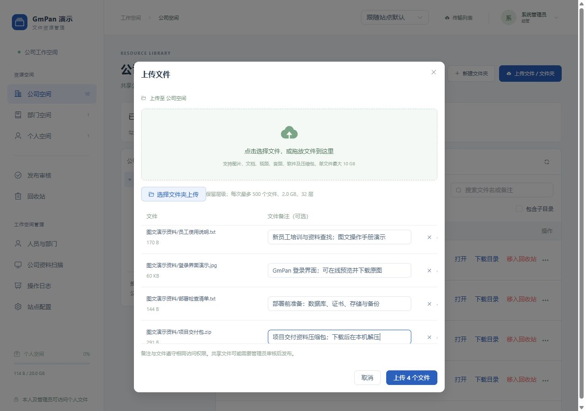

同一目录不覆盖同名项目，回收站内的同名项目也会占用名称。出现重名提示时，先确认是重复上传、需要恢复旧文件，还是确实需要改名保存另一份。

### 暂停和续传

1. 右上角打开“传输列表”，上传时可点击“暂停当前上传”。
2. 继续时选择“选择原文件续传”，提供原文件；文件名和大小须一致，系统还会核对分片。
3. 未完成任务保留 48 小时。超时清理后需重新上传。
4. 目录上传中的已完成文件不会因后续文件失败而回滚；只处理未完成部分，避免重复提交整个目录。

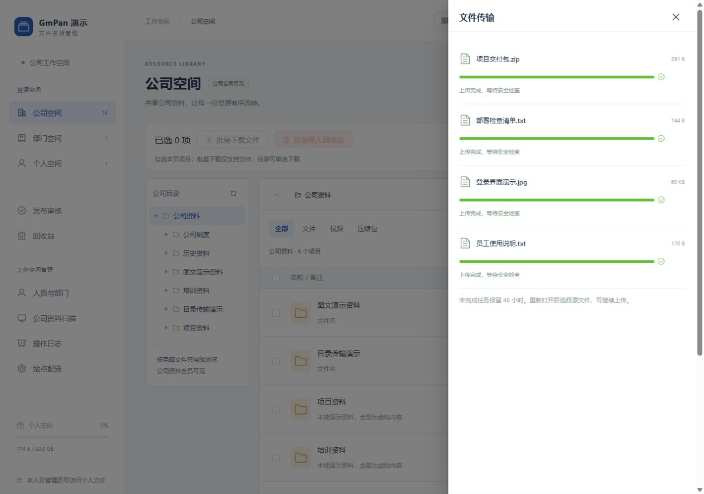

普通单文件默认上限为 10 GiB，以部署配置为准；**能够上传不代表一定能通过当前病毒引擎的安全检查**。出现检查限制时联系维护管理员。立即模式须检查通过；不启用或定时模式允许访问未检查文件，已失败或发现威胁的文件仍阻止访问。

## 五、备注与搜索

1. 上传时可填备注；已有文件可从行末“…”→“查看详情”打开详情面板。有编辑权限时点击备注旁的“编辑”，或使用“编辑名称和备注”。
2. 填写清楚的名称、用途和关键词，备注最长 2000 字符。保存只改系统内的名称和备注，不改磁盘源文件名。
3. 搜索框输入文件名的一部分，或备注中的关键词。例如备注为“部署前准备：数据库、证书、存储与备份”，输入“数据库”也能找到“部署检查清单.txt”。
4. 公司空间默认只搜当前目录；需要递归搜索时勾选“包含子目录”。部门和个人空间搜索限当前所选空间内有权访问的内容。
5. 搜索不到时，检查空间归属、当前目录、分类、是否包含子目录，以及文件是否尚未发布。

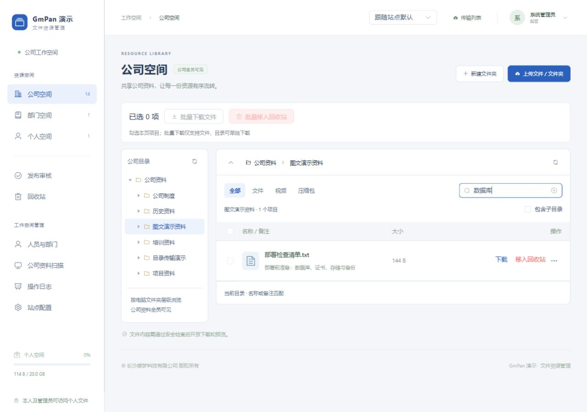

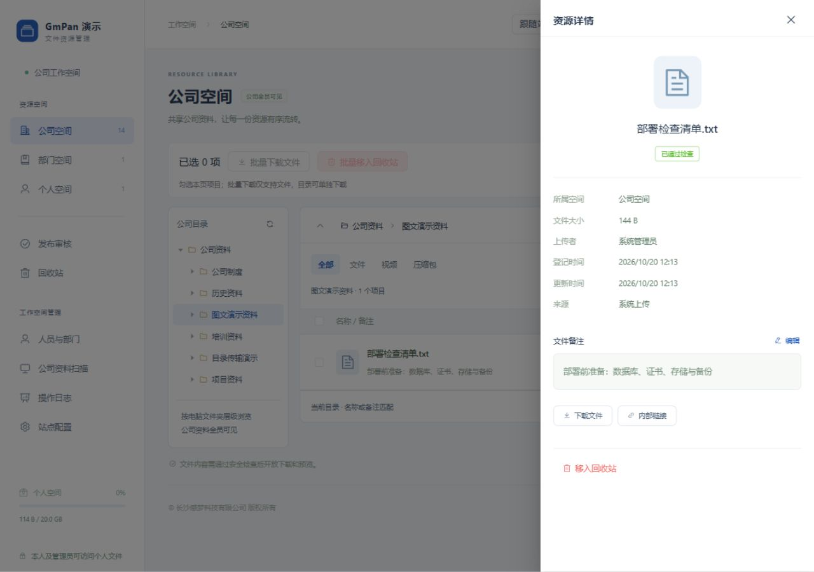

备注与文件使用相同访问权限，不会因填写备注而额外公开内容。普通员工修改共享文件的名称或备注后，需要管理员重新审核。

## 六、图片、视频与文件预览

1. 图片行点击“预览”，或直接点击可预览的图片名称。
2. 在线窗口查看图片；点击“下载原文件”保存原始图片。系统不会将其转换为截图或压缩图。
3. 公司空间中兼容的 MP4、WebM 视频显示“播放”；其他空间可从文件详情点击“在线预览”，使用播放器的播放、暂停及进度控制。
4. 浏览器支持的 PDF 和音频可从文件详情在线预览；无法播放或不支持的格式下载原文件后使用本机软件打开。

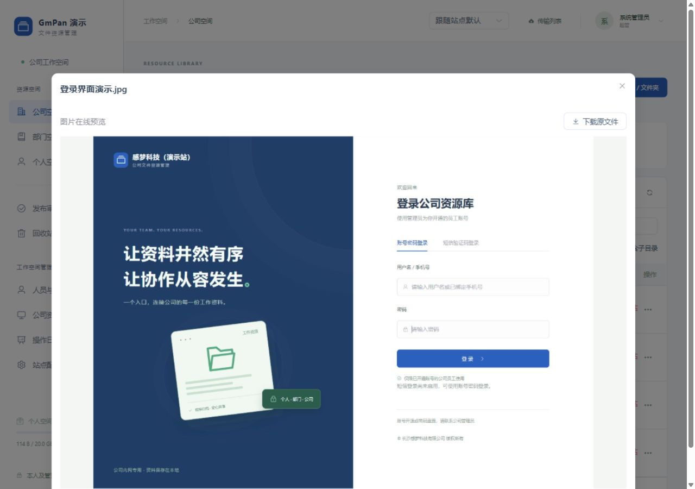

图片支持 JPEG、PNG、GIF、WebP、AVIF、BMP，实际显示取决于浏览器。视频容器相同也可能因编码不兼容而无法播放，首期不提供转码。HTML、SVG 等主动内容不在页面内执行；压缩包提供下载，不提供在线解压。立即模式下未通过安全检查不能预览或下载；不启用或定时模式的未检查文件允许访问，并标注“未执行病毒检查”。已发现威胁、检查失败、源文件缺失或无权限时仍不能访问。

## 七、文件及目录下载

### 单文件

点击文件行“下载”或下载图标，也可在详情点击“下载文件”。文件保存在浏览器设置的下载目录，下载前检查文件状态。

### 同一目录多个文件

1. 进入目标目录，勾选本页需要的文件。
2. 确认“已选 N 项”，点击“批量下载文件”。
3. 等待准备完成，浏览器收到“批量文件.zip”。解压后为所选文件，不包含其他未选文件。

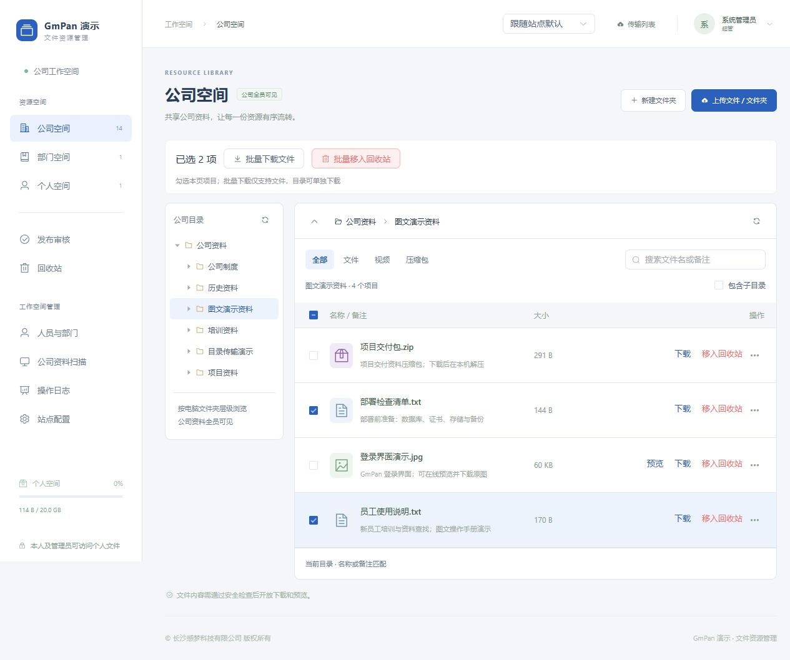

只支持同一目录的文件，最多 500 个文件、合计 2 GiB。不能混选目录；递归搜索结果来自不同目录时也不能批量下载。换目录、搜索、刷新或切换主题、视图后，选择会清空，请重新核对。

### 单个目录及其子目录

1. 回到目标目录的上一级，在目录行点“下载目录”；或在目录详情点“下载目录 ZIP”。
2. 系统将所选目录及其子目录、当前账号有权访问且可下载的资料打包，保留层级及已登记空目录。
3. 每批上限为 500 文件、2 GiB、32 层、1000 项；较大目录拆分到下级目录分别下载。

不能批量下载多个目录。服务器一次只处理一个 ZIP 打包或下载任务，忙碌时稍后重试。临时取件链接绑定本人、五分钟内一次有效；下载断开或链接过期后重新生成，不支持 ZIP 跨请求续传。

ZIP 只包含系统已登记的资料，回收站内容不进入打包。不可见文件不会进入包；若当前账号可见的某个文件尚未检查、被阻止、变更或缺失，整包会提示失败，处理后再下载。系统会检查临时磁盘空间，容量不足时不能生成 ZIP。

## 八、回收与恢复

1. 在文件或目录行，直接点击下载旁的“移入回收站”。
2. 核对确认框；目录会连同子项处理。批量处理时可混选同一目录中的文件和目录，再点“批量移入回收站”。
3. 打开左侧“回收站”，选择正确的公司、部门或个人空间；管理员处理其他归属时，还应核对员工或部门选择。
4. 找到项目，点击“恢复”，返回原空间和原目录检查结果。

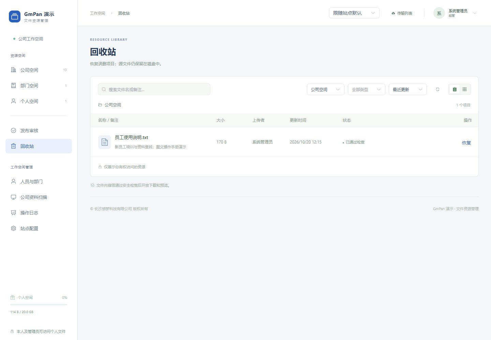

最多一次选择 500 项，包含子项合计不超过 10000 项；任意项目没有管理权或状态变化时整批拒绝。恢复目录不会自动恢复此前单独回收的子项。

回收只改变系统索引，磁盘原文件保留，也仍占磁盘和个人配额。当前没有永久删除或清空回收站入口。不要直接到服务器删除 `.gmpan` 中的对象文件来“清理空间”，需要释放容量时交由维护人员备份后处理。

## 九、发布审核

1. 员工向公司或部门空间上传文件后，按站点病毒检查策略处理，再等待管理员发布。
2. 超管、维护管理员从“发布审核”选择相应空间；部门管理员仅审核本部门资料。
3. 检查文件详情、备注和内容，核对病毒检查状态及内容后点击“通过”（立即模式须先检查通过）；不适合发布的点击“退回”。
4. 通过后，相应公司或部门范围内的员工可见。退回后由提交人调整内容信息，再交管理员复核。

个人文件不需要发布审核。超管、维护管理员上传的共享资料，以及部门管理员在本部门上传的资料可直接发布，但文件内容仍受站点病毒检查策略约束。不要把“审核通过”和“安全检查通过”混为一个状态。

## 十、人员与部门管理

仅超管和维护管理员可进入“人员与部门”；部门管理员不负责开通全公司账号。

1. 点击“新增部门”，填写名称并选择上级部门，确认创建。
2. 点击“新增员工”，填写用户名、姓名、初始密码，选择所属部门和角色。
3. 用户名为字母开头的 3～32 位字母、数字或 `_.-`；密码为 10～72 字节。手机号可选，绑定时必须唯一。
4. 根据工作需要设置个人空间配额和账号状态，再点击“保存员工”。
5. 在列表“编辑”中调整角色、部门、配额或停用；重置密码时输入新密码，留空保留原密码。
6. 员工账号调整保存后，其已有登录会话失效，需要重新登录；离职账号先停用，再按公司交接规则处理资料。

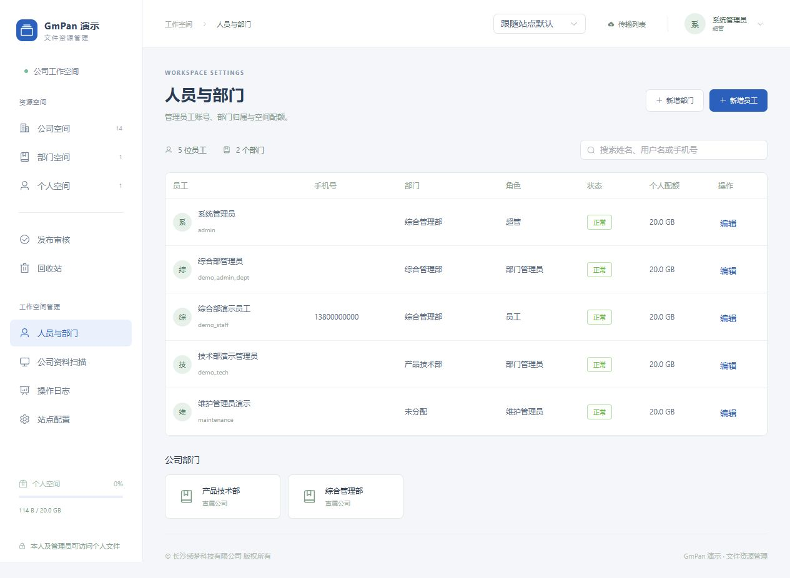

维护管理员不能新增或提升超管，也不能修改、重置或停用超管账号。请由超管维护自己的管理账号；不要把多人共用账号当作正常的人员管理方式。

## 十一、已有资料扫描

1. 由超管在站点配置核对服务器“文件存储和读取目录”，必要时按部署手册重启生效。
2. 确认目录内除系统保留的 `.gmpan` 外，资料均可对公司全员公开。个人私有资料不应直接放入公开扫描目录。
3. 超管或维护管理员进入“公司资料扫描”，核对“扫描目录”，点击“扫描历史资料”并确认。
4. 等待任务完成，检查新增、更新、跳过和异常数量；出现“部分完成”或“已中断”时按提示处理，再次扫描。
5. 回到公司空间的“历史资料”，检查层级和样本文件。立即模式须检查通过后才能下载或预览；不启用或定时模式下，尚未检查的文件可按权限访问并明确标注。

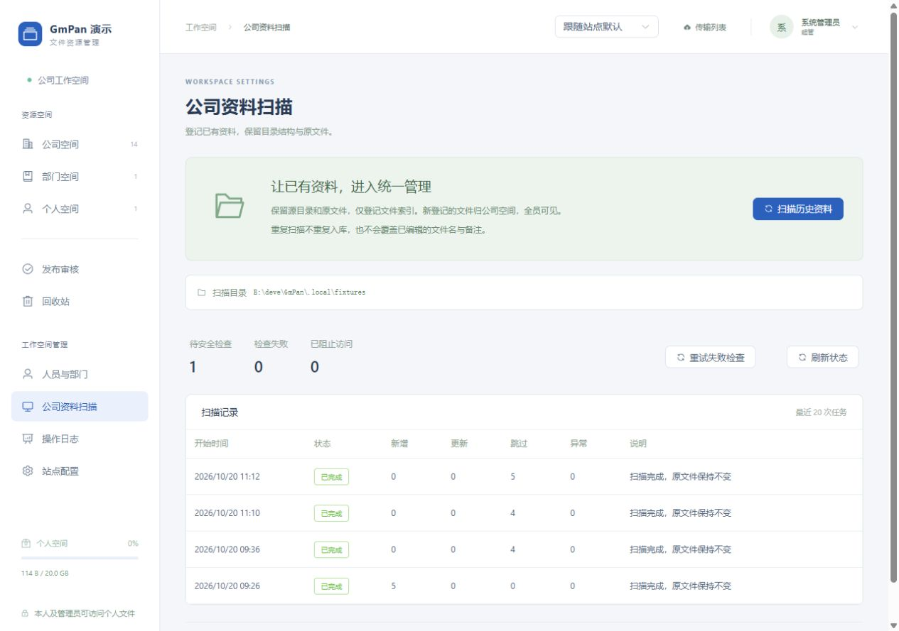

扫描不搬动或删除源文件，重复扫描不重复登记，也保留已修改的展示名称及备注。目录变化后需再次扫描；源文件缺失会标记不可用，不等于自动删除索引。`.gmpan`、符号链接、目录联接等不会作为公开资料导入。

“重试失败检查”重新排队安全检查，不代替历史目录扫描。扫描程序或病毒库异常时先由维护人员排查，不要连续重复点击。

## 十二、站点与短信配置

### 站点与目录（仅超管）

1. 进入“站点配置”→“站点与目录”。
2. 填写公司名称、简称；按需上传 PNG/JPEG Logo，文件不超过 2 MB，宽高各不超过 1024 像素。上传 Logo 立即生效。
3. 选择站点默认主题，填写底部版权说明和链接，再“保存站点配置”。
4. 点击“文件存储和读取目录”或“变更目录”，在弹窗中浏览部署服务器磁盘及子目录；也可输入服务器完整路径后“浏览”，最后“选择当前目录”。“站点部署目录”只读，不是用来搬移程序的输入框。
5. “剩余空间告警阈值”默认为 10%，可设 1～99%。低于阈值时系统提示维护，不会自动清理文件。

只有空站点能直接切换文件目录。已有上传文件、历史索引或未完成任务时，仍需先备份并按部署手册停服迁移，不会通过改路径丢弃原资料。新目录须由服务器维护人员授予服务账号相应访问权限。

目录发生变化时会提示：“目录变更后，请重新扫描新目录中的资料；扫描完成前，新增或变更的文件可能无法搜索到。”保存并重启生效后，到“公司资料扫描”手动扫描新目录。选择目录不会自动公开或扫描资料。

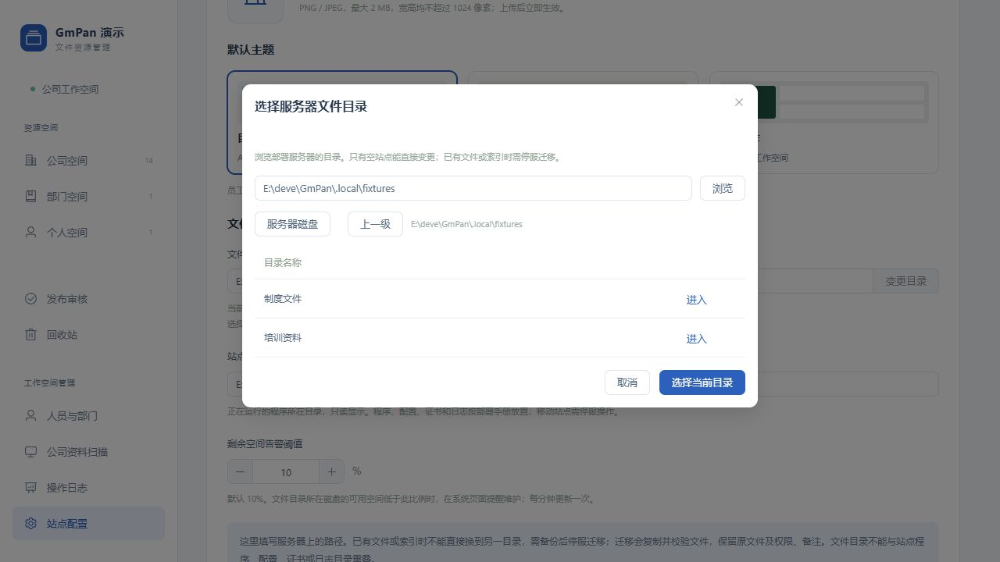

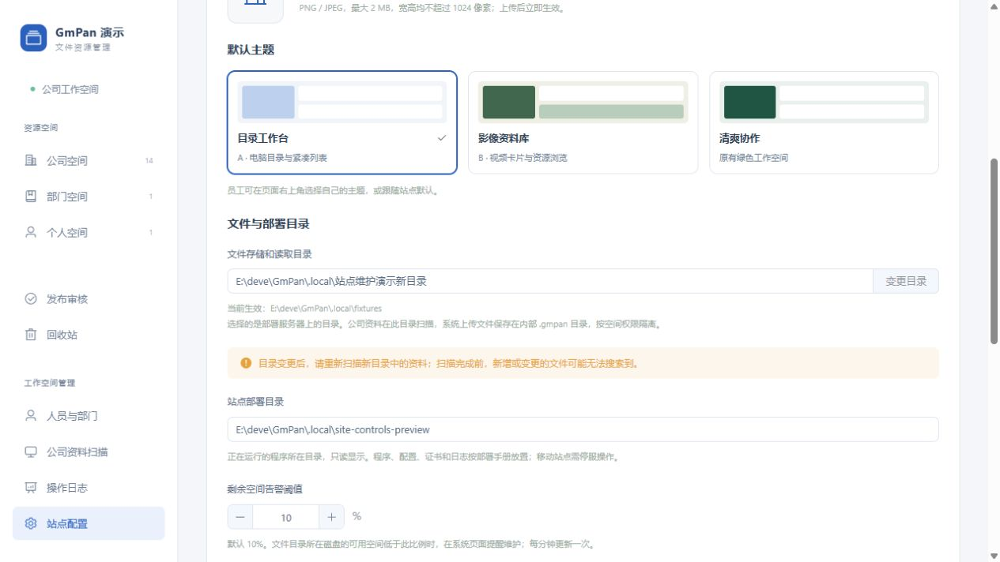

### 监听端口与站点重启（仅超管）

1. 在“站点运行”点击“修改监听端口”，输入 1～65535 的端口并保存。端口被占用或配置版本过期时会拒绝保存。
2. 页面区分当前端口与待生效端口。保存端口不会立即中断连接，重启后使用新端口。
3. 保存其他未完成的站点修改，再点击“重启站点”并确认。资料扫描运行期间会阻止重启，请等待扫描完成；其他连接会短暂中断，未完成上传可在恢复后续传。
4. 端口未改变时，页面等待站点恢复并自动重新加载；端口改变时，点击页面给出的新访问地址。若暂时无法打开，稍后重试并核对防火墙。
5. 站点重启重新加载 GmPan 网页服务和后台任务，保留账号、权限及登录会话；不重启服务器操作系统或 MySQL。

新版图形部署包按 GmPan 程序放行专用/域网络内的同子网 TCP 连接，可随程序监听端口变化。旧部署若按固定端口放行，需维护人员在变更前同步允许新端口。后台不会擅自提升操作系统权限或修改其他程序的规则。

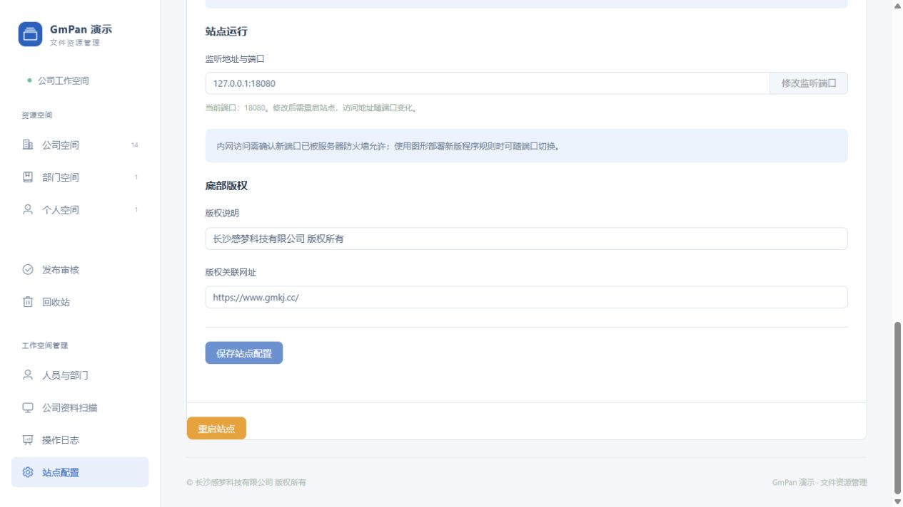

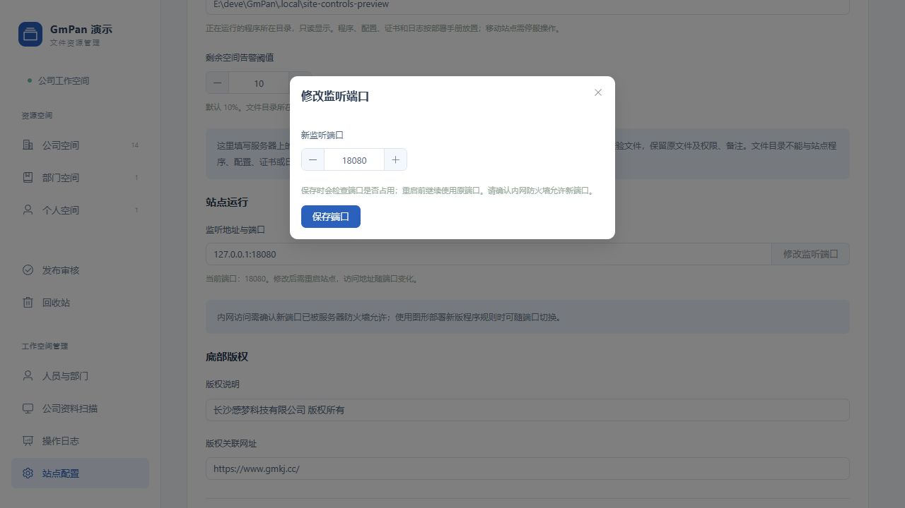

### 病毒检查设置（仅超管）

进入“站点配置 → 病毒检查”，选择模式后点击“保存病毒检查设置”，立即生效，不需要重启或重新扫描历史目录。已有站点升级后保留立即检查模式，由超管按需要调整。

| 模式 | 运行方式 | 未检查文件能否预览、下载 |
| --- | --- | --- |
| 不启用 | 不启动病毒检查，不为杀毒读取整份文件计算哈希 | 可以，标注“未执行病毒检查” |
| 立即检查 | 持续处理待检查队列 | 不可以，须检查通过 |
| 定时检查 | 仅在设置的每日时间段处理队列 | 可以，标注“未执行病毒检查” |

定时默认北京时间（UTC+8）22:00—次日 06:00，支持跨午夜。时间段结束或保存策略时，会取消正在进行的检查并将该文件放回待检查队列；下次从该文件重新检查，不支持从文件内部断点续扫。排队文件会跨服务重启保留。服务器关机时不会执行计划。

所有模式均保留空间权限和发布审核。已经发现威胁或检查失败的文件继续阻止访问；关闭检查不会把记录伪装成“已通过”。没有检查不代表安全，也无法收回已经下载的文件。上传分片、文件传输和目录打包的完整性校验仍然保留。

历史资料新登记时会读取文件头识别图片、视频等类型，无需等待杀毒。旧索引尚未识别的类型可重新扫描目录补充。

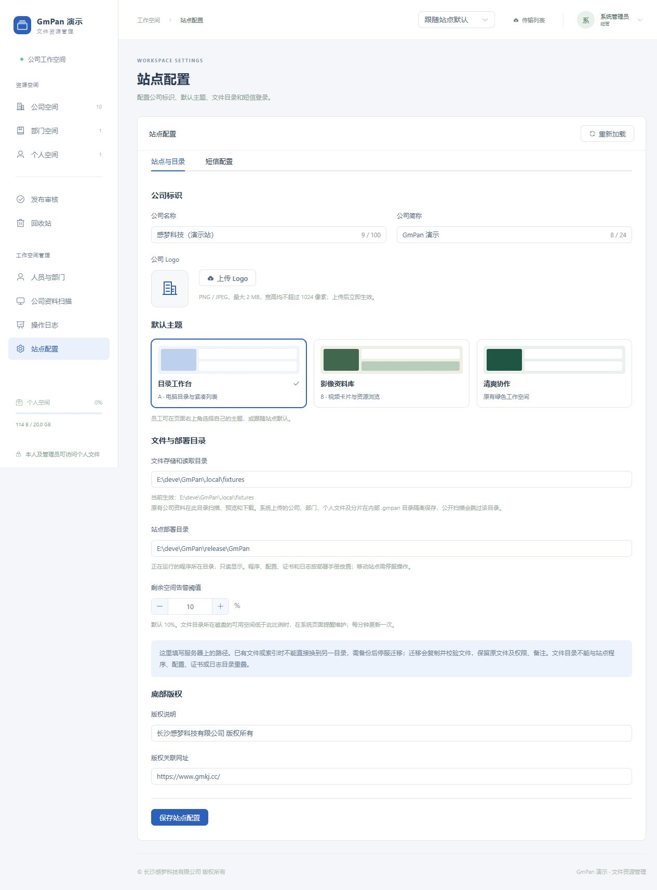

名称、主题、版权保存后生效，其他已打开页面刷新后显示。文件根目录变更需重启；已有文件、索引或任务时不允许直接切换，换盘请按部署手册停服、备份并执行迁移。截图中的开发路径不能原样复制到部署电脑。

### 短信配置（仅超管）

1. 在短信平台准备独立项目、AppKey、AppSecret 和已开通的验证码场景，核对额度及出口 IP 白名单。
2. 进入“站点配置”→“短信配置”，填写 HTTPS 接口基址、凭证及场景，再启用并保存。
3. 凭证保存后不回显，输入框留空表示保留。清除时先关闭短信，再勾选“清除已保存的 AppKey 和 AppSecret”，保存。
4. 保存本身不发送短信；使用已绑定手机号的测试账号，按确定的测试条数验证，再通知员工使用。

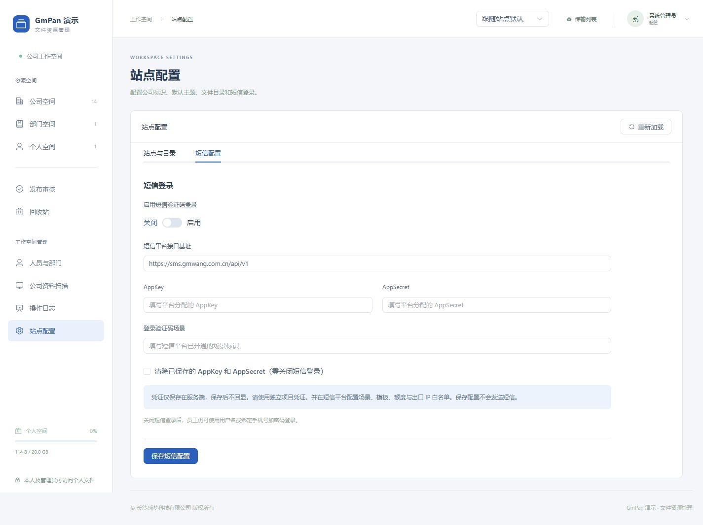

短信配置仅通过本后台管理，保存在数据库中，保存后立即生效，无需修改配置文件或重启服务。新安装默认关闭短信登录。

短信未接入时保持关闭，账号密码登录仍可用。接口失败或未收到验证码时可改用密码登录；不要在截图、公开仓库或日志中发布真实凭证和验证码。

## 十三、主题、日志与日常维护

右上角“界面主题”可选择目录工作台、影像资料库、清爽协作或“跟随站点默认”。个人偏好只保存在当前浏览器，不改变空间和文件权限。

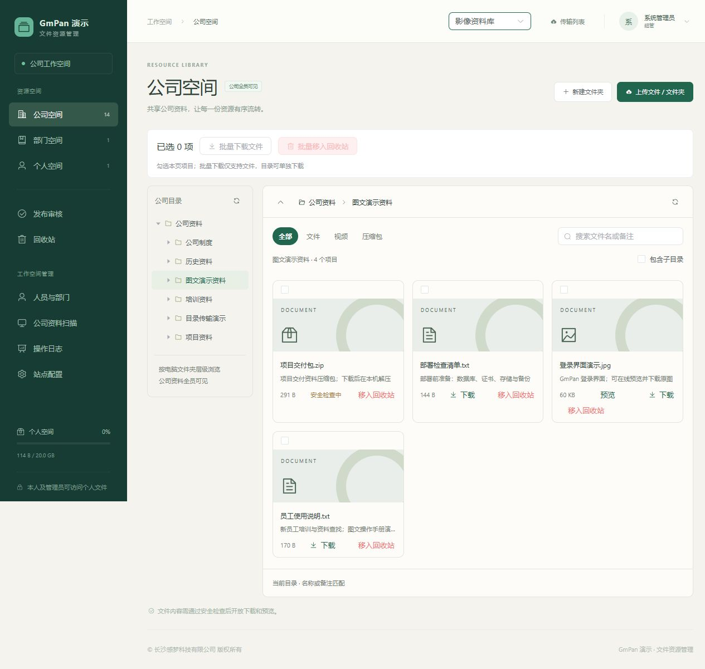

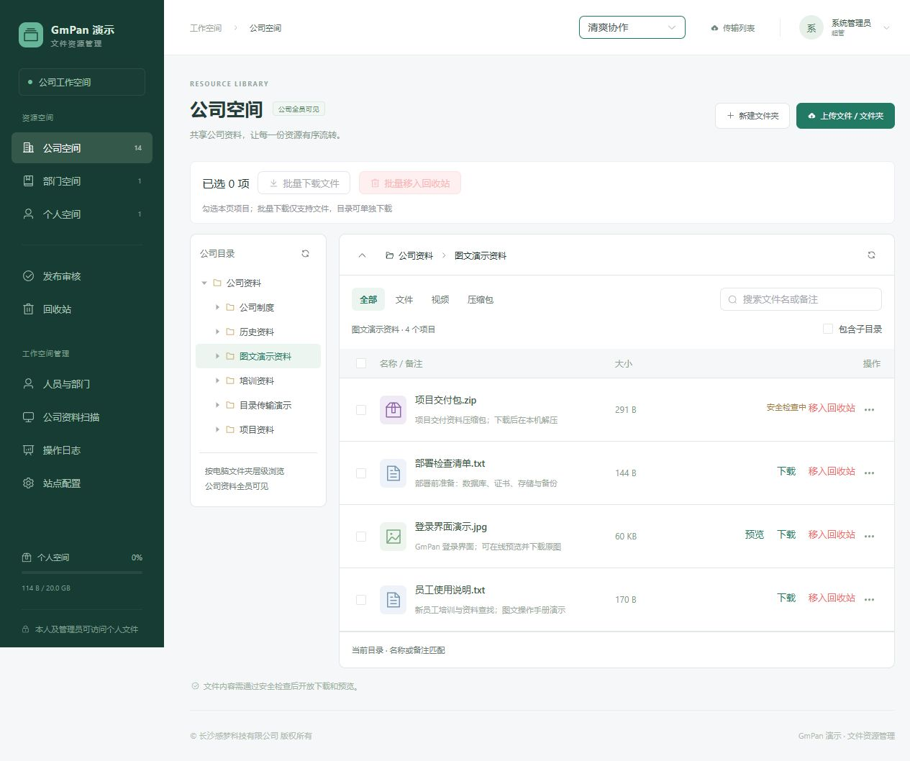

超管和维护管理员进入“操作日志”查看登录、上传、编辑、回收、恢复、审核和扫描等记录。页面展示最近操作，完整日志归档和数据库备份由部署维护人员执行。

出现“文件存储空间不足，需要维护”时，联系超管或维护管理员核对磁盘容量，安排归档、扩容或迁移。回收文件不会释放容量。无法获取容量时，应检查磁盘、网络目录和服务账号权限。

## 十四、常见问题

| 现象 | 处理步骤 |
| --- | --- |
| 账号无法登录 | 核对用户名或绑定手机号、密码、账号是否停用；联系管理员重置，勿重复尝试过多次 |
| 看不到某个部门 | 核对自己是否属于该部门；父子部门不自动共享，跨部门访问需有全空间管理权限 |
| 普通员工看不到新上传的共享文件 | 先检查安全状态及发布审核；提交人能看到待审核内容，不代表已向全员发布 |
| 文件可见但没有下载按钮 | 查看详情中的安全检查、源文件缺失或变更提示；联系维护人员处理 ClamAV、病毒库或源文件 |
| 搜索不到已知文件 | 清除分类，核对空间和目录，公司空间尝试“包含子目录”；搜索范围是文件名和备注，不含文件内容 |
| 批量下载按钮不可用 | 只选当前同一目录的文件，取消目录和跨目录结果，确认文件均可下载 |
| ZIP 提示忙碌或容量不足 | 等其他打包或下载结束；按上限分批，联系管理员检查临时空间与告警阈值 |
| 上传重名或配额不足 | 检查当前目录及回收站同名内容；不要重复上传已完成部分；联系管理员处理配额或归档 |
| 视频无法播放、图片无法显示 | 核对安全状态和浏览器兼容性，尝试下载原文件；系统不自动转码 |
| 回收后容量没有减少 | 这是软删除的正常行为；需要物理清理由维护人员按备份和维护流程处理 |
| 历史目录新增文件没有出现 | 联系超管或维护管理员重新扫描，“刷新列表”不会扫描服务器磁盘 |
| 短信收不到 | 先改用密码登录，再由超管检查平台场景、额度、出口 IP、服务器时间和网络 |

向维护人员反馈时，提供页面操作、文件名、所在空间、发生时间和提示文字即可。不要在公开 Issue 中上传账号密码、短信密钥、完整日志或真实业务文件。
